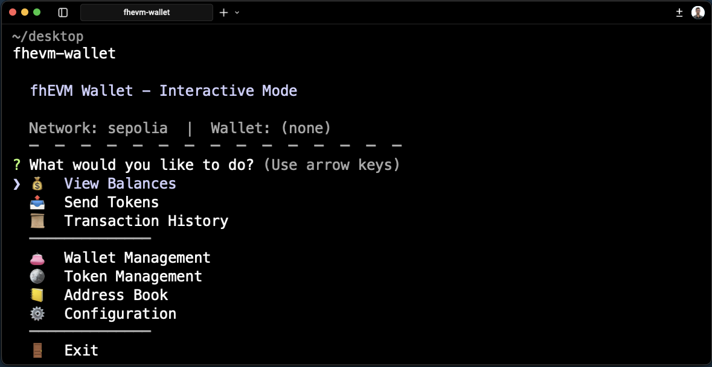

# fhEVM Wallet

A CLI wallet for managing encrypted ERC-7984 tokens using Zama's Fully Homomorphic Encryption (FHE) technology.

## Features

- **Interactive terminal UI** - Status bar, numbered menus, a send wizard with safety checks, `?` help and a `:` command bar
- **Wallet Management** - Create new wallets or import existing ones via mnemonic phrase or private key
- **Confidential Token Tracking** - Add and manage ERC-7984 tokens; every token is checked for ERC-7984 before it is added
- **Find tokens** - Discover tokens from known lists and from confidential transfers sent to your wallet
- **Doctor** - One command checks Node, the data folder, RPC, the Zama relayer, gas and every token
- **Receive with a QR code** - Your address (or an EIP-681 link) as a terminal QR code
- **Scriptable** - `--json` on non-interactive commands
- **Encrypted Balance Viewing** - One signature decrypts every tracked balance; balances refresh in the background after unlock and after each send
- **Decrypted History** - Transfer amounts you sent or received are decrypted once and cached
- **Operators** - See, grant (with an expiry) and revoke ERC-7984 operators
- **Disclosure** - Publish one transfer amount on-chain with its decryption proof
- **Confidential Transfers** - Send tokens with end-to-end encryption
- **Address Book** - Save frequently used addresses with friendly names
- **Multi-Network Support** - Works on Ethereum Sepolia testnet and Mainnet



## Installation

Requires Node.js >= 24.11.

```bash
# npm
npm install -g fhevm-wallet

# yarn
yarn global add fhevm-wallet

# pnpm
pnpm add -g fhevm-wallet

# bun
bun add -g fhevm-wallet
```

## Usage

Run `fhevm-wallet` or the shorter alias `fhew` to start the interactive terminal UI
(`fhew interactive` does the same):

```bash
fhew
```

The first start walks you through setup: wallet, network, a token and ETH for gas.
Then, on any screen:

| Key | Action |
| --- | --- |
| ↑ ↓ / k j, Enter | Move and select |
| 1-9, 0 | Jump to a numbered item; 0 quits from Home |
| b s r h d | Balances, Send, Receive, History, Doctor (on Home) |
| . | Repeat your last send (stops on Review) |
| Esc | Back one step, keeping what you typed; stops a send countdown |
| Ctrl+C | Back to Home; twice on Home quits |
| : | Command bar: `send bob 25 cusdc`, `balances`, `doctor`, `lock`, `help`, … |
| ? | Help for the current screen |
| L (or l) | Lock now (the decrypted key is only ever held in memory) |

Sends go Token → Recipient → Amount → Review → Sign. Amounts accept `25`, `1,250.50`,
`1k`, `half` and `max` and show the exact value. A pasted address that looks like a saved
contact stops the send; a first-time address is flagged; after the send you can save it.
On Mainnet you retype the amount and a countdown always runs before broadcasting.

Try the UI without any network or funds against the offline simulation (a `MOCK` badge is
shown). It needs a throwaway data folder, so simulated tokens and history stay out of your
real one. It marks the folder with a `.fhew-mock` file, refuses any folder that already
holds wallet data, and the real wallet then refuses the marked folder:

```bash
FHEW_BACKEND=mock FHEVM_WALLET_HOME=$(mktemp -d) fhew
```

### Wallet Commands

```bash
# Create a new wallet
fhew wallet create my-wallet

# Import wallet from mnemonic
fhew wallet import my-wallet --mnemonic

# Import wallet from private key
fhew wallet import my-wallet --key

# List all wallets
fhew wallet list

# Set default wallet
fhew wallet set-default my-wallet
```

### Token Commands

```bash
# Add a token to track (checked for ERC-7984 first; --force adds one that fails)
fhew token add 0x...

# Find tokens you may hold: known lists plus transfers sent to your wallet
fhew token find                       # list candidates with their source and status
fhew token find --all-verified        # add the verified ones
fhew token find --add 0x... 0x...     # add specific candidates
fhew token find --no-scan             # known lists only
fhew config --token-list-url https://example.org/tokens.json   # your own list ("none" clears)

# List tracked tokens
fhew token list

# Remove a tracked token
fhew token remove 0x...
```

### Balance & Transfers

```bash
# View balances for all tracked tokens
fhew balance

# View balance on specific network
fhew balance --network mainnet

# Send tokens (interactive prompts)
fhew send

# Send tokens with arguments: contact or address, friendly amount, token symbol or address
fhew send bob 25 cusdc
fhew send 0x... 1,250.50 --token 0x...
fhew send bob half cusdc

# In scripts: the password from a pipe, no confirmation prompt (the checks still run)
pass show my-wallet | fhew send bob 25 cusdc -n sepolia --password-stdin --yes
pass show my-wallet | fhew balance --password-stdin

# Mainnet without a confirmation prompt needs both -n mainnet and --mainnet
pass show my-wallet | fhew send bob 25 cusdc -n mainnet --mainnet --password-stdin --yes
```

### History, Operators and Disclosure

```bash
# Decrypt confidential amounts in history (one signature for all tracked tokens)
fhew history --decrypt
pass show my-wallet | fhew history --decrypt --password-stdin

# Operators: an operator can move ALL of your tokens until it expires
fhew operator list                       # contacts and recent addresses
fhew operator set 0xExchange… --for 1d   # 1h, 1d, 7d, 2w, a date, or forever (typed confirmation)
fhew operator revoke 0xExchange…

# Make one transfer amount public on-chain (request, then publish with the KMS proof)
fhew disclose <txHash>
```

The decrypt signature (an EIP-712 user-decrypt authorisation, valid 1 day by default;
`FHEW_DECRYPT_DAYS` sets 1-365) is kept in memory only and dropped on lock, auto-lock,
wallet switch and exit. Operator changes and disclosures go through the same checks as a
send: simulation, fee, an explicit confirmation and, after the broadcast, the transaction
hash even when the confirmation is lost.

A pasted address that looks like one of your contacts stops the send. Without a
terminal, prompts are never shown: pass the values as arguments, `--password-stdin` and
`--yes`. On Mainnet, a send that would skip the confirmation (`--yes`, or no terminal) is
refused unless the command line itself says `-n mainnet` **and** `--mainnet`, so a
default network set in the config can never send real funds unasked. In a terminal
without `--yes`, a Mainnet send asks you to retype the amount, as the terminal UI does.
Exporting a raw private key is interactive only.

Find tokens labels each candidate. **verified**: on a known list and it passes the
ERC-7984 check. **unverified**: it sent your wallet a transfer but is on no list (anyone
can send you a token, so only add ones you recognise). **not ERC-7984**: refused unless you
pass `--force`. The history scan reads `ConfidentialTransfer` logs over RPC in chunks,
remembers where it stopped (per wallet and network) and can be stopped with Ctrl+C (Esc in
the terminal UI). The lists shipped with the wallet are empty for now: no official list of
ERC-7984 token addresses could be verified (see [docs/token-lists.md](docs/token-lists.md)).

### Doctor, Receive

```bash
fhew doctor            # exit code 1 if anything needs fixing
fhew receive           # address and QR code; --eip681 puts the network in the QR too
```

### JSON output

`fhew wallet list`, `token list`, `token find`, `balance`, `history`, `config --show`,
`doctor`, `receive` and `send` accept `--json`: one JSON document on stdout, stable
camelCase keys, amounts in base units as strings, no colours. Errors are
`{"error": {"code": "...", "message": "..."}}` with exit code 1 (send errors after a
broadcast also carry `txHash` and `explorerUrl`: check those before sending again). RPC URLs
and keys are masked like in the text output. Prompts would break the JSON, so `balance`
needs `--password-stdin`, and `send` needs `--password-stdin`, `--yes`, a recipient and an
amount.

```bash
pass show my-wallet | fhew balance --json --password-stdin | jq '.tokens[].formatted'
```

### Configuration

```bash
# View current configuration
fhew config --show

# Set default network
fhew config --network sepolia

# Set RPC endpoints (https only; the wallet checks the chain ID before saving).
# Use - to type the URL hidden, so its key stays out of your shell history.
fhew config --rpc-mainnet https://mainnet.infura.io/v3/YOUR_KEY
fhew config --rpc-sepolia -

# Set API keys
fhew config --etherscan-key YOUR_ETHERSCAN_KEY
fhew config --zama-key YOUR_ZAMA_KEY
```

### Global Flags

```bash
# Use specific network for any command
fhew balance --network mainnet
fhew send 0x... 100 -n sepolia
```

## Data Storage

All data is stored in `~/.fhevm-wallet/` (set `FHEVM_WALLET_HOME` to use another folder):

```
~/.fhevm-wallet/
├── wallets/           # Encrypted keystore files
├── .env               # RPC URLs and API keys saved by `fhew config`
├── config.json        # CLI configuration
├── tokens.json        # Tracked tokens
├── addressbook.json   # Saved contacts
├── transactions.json  # Local transaction history
├── audit.log          # Wallet events (never amounts, keys or phrases)
├── balance-cache.json # Cached balances
└── amount-cache.json  # Decrypted transfer amounts, by ciphertext handle
```

The folder is readable only by you (`0700`, files `0600`), and files are replaced
atomically so a crash cannot leave half a keystore behind. Data written by older versions
is tightened automatically the next time the wallet starts.

## Documentation

- [Wallet Guide](docs/wallet.md) - Detailed wallet, token, and balance documentation
- [Development](docs/development.md) - Local development setup
- [Docker](docs/docker.md) - Docker setup
- [Contributing](CONTRIBUTING.md) - Contribution guidelines

## Security

- Wallets are encrypted locally using standard Ethereum keystore format with scrypt
- Your password never leaves your machine
- Recovery phrases and private keys are shown on a separate screen that is wiped when you
  press a key, so they do not stay in your terminal scrollback
- Prefer `fhew wallet export <name> --keystore <file>` for backups: the file stays
  encrypted with your password
- Before sending, the wallet checks the RPC serves the right chain and that your decrypted
  balance covers the amount (ERC-7984 transfers that exceed the balance move 0 instead of
  failing); after sending it re-checks that the balance went down
- **Write down your recovery phrase** - anyone with it can access your funds
- Start with testnet (Sepolia) before using mainnet

## License

MIT
